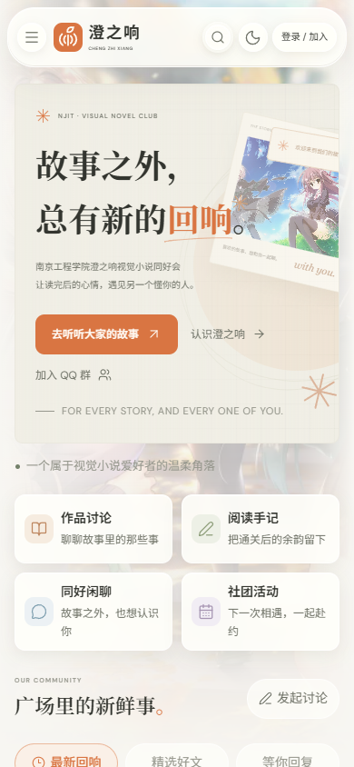
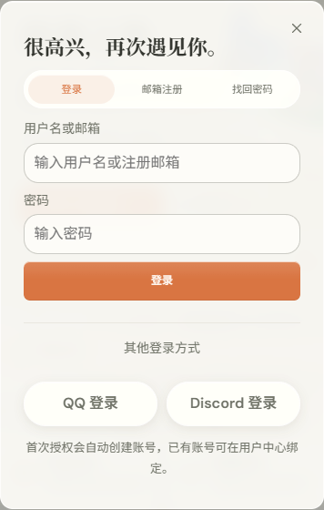

<p align="center">
  
</p>

<h1 align="center">澄之响 · Galweb</h1>

<p align="center">
  <strong>南京工程学院澄之响视觉小说同好会社区</strong><br />
  故事之外，总有新的回响。让读完后的心情，遇见另一个懂你的人。
</p>

<p align="center">
  <a href="https://njitgal.cn"></a>
  <a href="https://github.com/YuyueDaV/galweb/releases/latest"></a>
  <a href="https://github.com/YuyueDaV/galweb/actions/workflows/quality.yml"></a>
  
  
  
  
</p>

<p align="center">
  <a href="https://njitgal.cn">在线体验</a> ·
  <a href="https://github.com/YuyueDaV/galweb/releases/latest">下载最新版本</a> ·
  <a href="docs/releases/v0.2.0.md">更新日志</a> ·
  <a href="docs/baota-deployment.md">宝塔部署</a> ·
  <a href="docs/edgeone-deployment.md">EdgeOne 部署</a>
</p>

---

## 项目简介

Galweb 是面向视觉小说同好会的社区网站，把作品讨论、阅读手记、作品书库、个人书单、Tier 榜和「十二橙器」评选放在同一个入口。成员可以分享故事、记录阅读，也可以一起提名、投票，留下每一届共同喜欢过的作品。

网站采用暖纸色与橙色主题，支持浅色／深色模式、毛玻璃界面和手机布局。访客可以浏览公开内容；发帖、收藏、提名和投票等操作会引导登录。

## 界面预览


<details>
<summary>查看手机端与第三方登录预览</summary>

<p align="center">
  
  
</p>

首页截图来自公开站点；第三方登录截图来自测试环境。QQ、Discord 按部署者的应用配置分别开放。

</details>

## 主要功能

| 模块                                           | 可以做什么                                                                                        |
| ---------------------------------------------- | ------------------------------------------------------------------------------------------------- |
| [社区广场](https://njitgal.cn/)                | 作品讨论、阅读手记、同好闲聊、社团活动；支持话题、搜索、排序、精选与待回复筛选。                  |
| [作品书库](https://njitgal.cn/works)           | Bangumi 搜索与作品导入，补充制作组、封面和来源；从作品进入相关讨论与阅读记录。                    |
| [十二橙器](https://njitgal.cn/awards)          | 按届次提名、审核、投票、补充投票与同票加赛，公布结果并归档；展示提名人及作品荣誉。                |
| [书单与 Tier 榜](docs/catalog-and-tiers.md)    | 记录阅读状态和短评，管理个人书单与个人 Tier 榜，参与共同投票统计。                                |
| [账号与个人空间](docs/social-login.md)         | 用户名／邮箱密码登录、邮箱验证与找回密码、QQ／Discord 授权及绑定、头像、签名和公开主页。          |
| [内容与社团管理](docs/community-experience.md) | Markdown 多图与剧透控制、草稿恢复、分组回复、站内通知、社团动态及相册；管理员审核内容和配置活动。 |

QQ／Discord 首次授权可以创建账号；已有账号可在用户中心绑定。应用密钥和回调配置见 [第三方登录说明](docs/social-login.md)。

## v0.2.0 更新

本次发布包含 QQ／Discord 登录与绑定、完整的十二橙器评选流程、作品来源与提名管理、通知编辑删除，以及手机界面和登录提醒的改进。

- **账号互通**：第三方登录、绑定／解绑、补充邮箱密码；用户名和邮箱都可登录，刷新后恢复会话。
- **一起选作品**：公开提名信息、阶段管理、加权投票、补充投票、同票加赛、结果与历届荣誉。
- **实时排名与超管维护**：投票排名每 5 秒更新；超级管理员可跨阶段补录、修改、移除恢复作品，维护来源、提名人和书库关联，公布后的票数及排名保留。见 [操作说明](docs/award-live-maintenance.md)。
- **更好地管理内容**：作品来源与关联书单、第二届 QQ 提名同步、通知管理、分组回复与上下文提醒。
- **更清晰的界面**：手机端控件与字号、圆润输入框、统一登录弹窗、加载反馈及页面加载优化。

完整变化、数据库迁移与升级步骤见 [v0.2.0 发布说明](docs/releases/v0.2.0.md)；历史版本见 [Releases](https://github.com/YuyueDaV/galweb/releases)。

## 快速启动

需要 **Node.js 24.16、pnpm 11.25、MySQL 8.0**。正式部署还需要 SMTP、域名和 HTTPS。

```bash
git clone https://github.com/YuyueDaV/galweb.git
cd galweb
pnpm install --frozen-lockfile
cp apps/api/.env.example apps/api/.env
```

先创建独立数据库，填写 `apps/api/.env` 中的 `DB_*`、`WEB_ORIGIN` 和 `AUTH_SECRET`，再运行迁移。开发模式可用 `MAIL_TRANSPORT=capture` 捕获测试邮件；正式环境使用真实 SMTP。[账号配置](docs/auth-setup.md)说明了具体字段。

```bash
pnpm db:migrate
pnpm dev:api
```

保持后端运行，在另一个终端启动网页：

```bash
pnpm dev
```

打开 [http://127.0.0.1:3100](http://127.0.0.1:3100)。Windows PowerShell 中使用 `pnpm.cmd`，避免脚本执行策略拦截。

## 部署与下载

推荐通过 Git 克隆持续维护；[最新 Release](https://github.com/YuyueDaV/galweb/releases/latest) 也提供源码 ZIP、tar.gz、版本说明及 SHA-256 校验文件。源码包需要在目标服务器安装依赖和构建，不包含数据库、上传文件和真实环境配置。

| 场景                | 说明                                                               |
| ------------------- | ------------------------------------------------------------------ |
| 宝塔 Linux 后端     | [NestJS、MySQL、SMTP、HTTPS、迁移与更新](docs/baota-deployment.md) |
| EdgeOne 前端        | [Nuxt SSR 构建、API 代理及环境变量](docs/edgeone-deployment.md)    |
| 服务器／Docker 部署 | [运行、首名管理员、备份与恢复](docs/deployment.md)                 |
| 升级到 v0.2.0       | [更新命令、迁移及第三方登录配置](docs/releases/v0.2.0.md)          |

## 项目结构

```text
apps/web/          Nuxt 4 + Vue 3：社区页面、组件与客户端状态
apps/api/          NestJS + MySQL：账号、论坛、书库、评选与管理接口
packages/domain/   共享业务规则、类型与校验
e2e/               Playwright 浏览器流程与手机布局检查
tests/             前端状态、渲染和共享规则测试
scripts/           检查、构建、图片处理及发布打包
docs/              配置、部署、功能说明与版本记录
```

## 开发与文档

```bash
pnpm typecheck       # 类型检查
pnpm test            # 单元与 API 测试
pnpm build:check     # 隔离目录中的构建检查
pnpm check           # 完整检查，包含隔离数据库和浏览器流程
```

完整检查的 MySQL、浏览器依赖及贡献约定见 [工程检查与样式规范](docs/quality-and-styling.md)。修改共享规则后运行 `pnpm rules:sync`。

- [书库、书单与 Tier 榜](docs/catalog-and-tiers.md) · [评选规则与接口](docs/awards-backend.md)
- [账号配置](docs/auth-setup.md) · [QQ／Discord 登录绑定](docs/social-login.md)
- [社区内容体验](docs/community-experience.md) · [通知管理](docs/site-notifications.md)
- [背景设置](docs/site-background.md) · [Liquid Glass 视觉层](docs/liquid-glass.md)
- [加载与性能](docs/frontend-performance.md) · [同好会宣传入口](docs/club-promotion.md)

插画、游戏封面和字体的权利及许可归各自权利人所有。素材来源、本地字体和历史数据说明见 [项目维护说明](docs/project-notes.md)。
